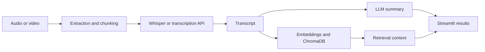

# 🧠 MeetMind

> **AI-powered meeting & video assistant that turns conversations into useful knowledge.**

MeetMind is an AI-powered application designed to process meeting recordings and online videos, convert speech into text, translate Hinglish conversations into English, and generate useful summaries from the resulting transcript.

It combines **local AI speech recognition**, **Sarvam AI**, **LangChain**, **Mistral**, and **RAG-based document retrieval** into a single Streamlit application.

---

## For AI/ML hiring teams

**Problem:** Meeting audio and videos are hard to search or summarize manually.

**Pipeline:** Audio/video ingestion → audio chunking → speech recognition (local Whisper or supported API path) → transcript → LLM summarization and embedding-based retrieval → Streamlit results.

**What this project demonstrates:** Python-based AI application integration, external speech/LLM APIs, text chunking, vector search using ChromaDB, and a user-facing workflow.

**Current evidence and limitations:** The repository contains application code and setup instructions, but **no verified hosted demo or screenshot** is provided here. Transcription speed depends on hardware and external services, and YouTube extraction may fail as third-party sites change. This is a portfolio prototype, not a guaranteed production deployment.

**Architecture at a glance**



[Features](#-features) · [Installation](#️-installation) · [Limitations](#-current-limitations)

---

## ✨ Features

* 🎥 **YouTube Video Processing**

  * Provide a YouTube URL and extract the audio automatically.
  * Audio is processed into smaller chunks for efficient transcription.

* 🎙️ **Speech-to-Text**

  * Uses **OpenAI Whisper** for local English transcription.
  * Supports **Sarvam AI** for Hinglish → English transcription/translation.

* 🌐 **Hinglish Support**

  * Processes Hindi-English mixed conversations.
  * Sarvam AI converts spoken content into an English transcript.

* ✂️ **Automatic Audio Chunking**

  * Long audio files are divided into smaller pieces.
  * Sarvam audio pieces are kept within the API's supported duration.

* 🤖 **AI Summarization**

  * Uses LangChain and Mistral to transform transcripts into concise summaries.
  * Helps extract the important information from long conversations.

* 🔎 **RAG Pipeline**

  * Uses vector embeddings and ChromaDB for retrieval-based workflows.
  * Enables the application to work with stored textual information.

* 📄 **Document Export**

  * Generate PDF/TXT outputs from processed content.

* 🖥️ **Streamlit Interface**

  * Simple web interface for uploading/processing meeting content.
  * Displays transcription and AI-generated results.

---

## 🏗️ Architecture

```text
                    ┌─────────────────────┐
                    │    YouTube URL      │
                    │   / Audio Input     │
                    └──────────┬──────────┘
                               │
                               ▼
                    ┌─────────────────────┐
                    │      yt-dlp         │
                    │    Audio Download   │
                    └──────────┬──────────┘
                               │
                               ▼
                    ┌─────────────────────┐
                    │   Audio Processing  │
                    │       Pydub         │
                    └──────────┬──────────┘
                               │
                               ▼
                    ┌─────────────────────┐
                    │    Audio Chunking   │
                    └──────────┬──────────┘
                               │
                     ┌─────────┴─────────┐
                     │                   │
                     ▼                   ▼
              ┌─────────────┐     ┌─────────────┐
              │   Whisper   │     │  Sarvam AI  │
              │ Local STT   │     │ Hinglish STT│
              └──────┬──────┘     └──────┬──────┘
                     │                   │
                     └─────────┬─────────┘
                               ▼
                    ┌─────────────────────┐
                    │      Transcript     │
                    └──────────┬──────────┘
                               │
                               ▼
                    ┌─────────────────────┐
                    │      LangChain      │
                    │     + Mistral LLM   │
                    └──────────┬──────────┘
                               │
                               ▼
                    ┌─────────────────────┐
                    │   AI Summary / RAG  │
                    │     / Insights      │
                    └──────────┬──────────┘
                               │
                               ▼
                    ┌─────────────────────┐
                    │     Streamlit UI    │
                    │   Export / Results  │
                    └─────────────────────┘
```

---

## 🛠️ Tech Stack

| Technology                | Purpose                               |
| ------------------------- | ------------------------------------- |
| **Python**                | Core application                      |
| **Streamlit**             | Web interface                         |
| **yt-dlp**                | YouTube audio extraction              |
| **FFmpeg**                | Audio conversion                      |
| **Pydub**                 | Audio processing & chunking           |
| **OpenAI Whisper**        | Local speech recognition              |
| **Sarvam AI**             | Hinglish speech-to-text & translation |
| **LangChain**             | LLM orchestration                     |
| **Mistral AI**            | AI summarization                      |
| **ChromaDB**              | Vector database                       |
| **Sentence Transformers** | Text embeddings                       |
| **Hugging Face**          | Embedding/model ecosystem             |
| **ReportLab / FPDF2**     | PDF generation                        |
| **python-dotenv**         | Environment configuration             |

---

## 📂 Project Structure

```text
MeetMind/
│
├── app.py
│
├── transcriber.py
├── summarizer.py
│
├── downloader.py
├── rag.py
│
├── downloads/
│
├── .env
├── requirements.txt
├── README.md
└── ...
```

> The exact file structure may vary depending on the current implementation.

---

## ⚙️ Installation

### 1. Clone the repository

```bash
git clone https://github.com/Devcodehub2004/MeetMind.git
cd MeetMind
```

### 2. Create the virtual environment

If you use **uv**:

```bash
uv venv
```

Activate it on Windows:

```powershell
.venv\Scripts\activate
```

### 3. Install dependencies

```bash
uv pip install -r requirements.txt
```

---

## 🎵 FFmpeg Setup

MeetMind uses FFmpeg for audio processing.

Verify that FFmpeg is installed:

```bash
ffmpeg -version
```

If the command is not recognized, install FFmpeg and add it to your system `PATH`.

---

## 🔐 Environment Variables

Create a `.env` file in the project root:

```env
SARVAM_API_KEY=your_sarvam_api_key

SARVAM_STT_MODEL=saaras:v2.5

WHISPER_MODEL=small

MISTRAL_API_KEY=your_mistral_api_key
```

### ⚠️ Important

Never commit your `.env` file or API keys to GitHub.

Add this to `.gitignore`:

```gitignore
.env
.venv/
__pycache__/
downloads/
*.pyc
```

---

## ▶️ Running MeetMind

Start the Streamlit application:

```bash
uv run streamlit run app.py
```

The application will be available at:

```text
http://localhost:8501
```

---

## 🎙️ Transcription Modes

MeetMind uses different transcription engines depending on the selected language.

### English

```text
Audio
  ↓
Whisper
  ↓
English Transcript
```

Whisper runs locally on the user's machine.

### Hinglish

```text
Audio
  ↓
Audio Chunking
  ↓
Sarvam AI
  ↓
English Transcript
```

This allows MeetMind to process conversations containing Hindi and English.

---

## 🔎 RAG Pipeline

MeetMind also includes a Retrieval-Augmented Generation workflow.

The basic process is:

```text
Transcript / Documents
        ↓
Text Splitting
        ↓
Embeddings
        ↓
ChromaDB
        ↓
Relevant Context Retrieval
        ↓
LLM
        ↓
Answer / Summary
```

This helps the application retrieve relevant information before generating an AI response.

---

## 🧩 Why MeetMind?

Meetings and long-form videos often contain a large amount of information that is difficult to manually review.

MeetMind aims to reduce that effort by transforming:

```text
Long Conversation
       ↓
Audio
       ↓
Transcript
       ↓
AI Processing
       ↓
Useful Information
```

Instead of manually listening to an entire recording, users can process the conversation and work with the resulting transcript and AI-generated content.

---

## 🚧 Current Limitations

* Local Whisper transcription can require significant CPU/GPU resources.
* Processing time depends on audio length and hardware.
* Sarvam API usage requires an API key.
* Internet connectivity is required for cloud-based services.
* YouTube extraction behavior can change as YouTube updates its platform.
* FFmpeg must be installed separately. `requirements.txt` installs Deno and yt-dlp's matching YouTube challenge scripts for YouTube audio extraction; a supported Node.js runtime is used as a fallback when Deno is unavailable.

---

## 🔮 Future Improvements

Potential improvements include:

* 👥 Automatic speaker identification
* 📝 Meeting minutes generation
* ✅ Automatic action-item extraction
* 📌 Key decision detection
* 🗓️ Meeting agenda generation
* 💬 Interactive transcript chat
* 🔍 Improved semantic search
* 🎯 Topic and keyword extraction
* 📊 Meeting analytics
* ☁️ Cloud deployment
* ⚡ GPU-accelerated transcription
* 📧 Automatic meeting-summary delivery

---

## 📸 Demo

Screenshots and a public hosted demo are **not yet provided** in this repository. To demonstrate the project in an interview, run the app locally and show an example you have permission to process: input, transcription, summary, and retrieval/question-answering. Avoid including private meeting recordings in screenshots.

---

## 🔒 Security

API keys and credentials should always be stored in environment variables.

Do **not** commit:

```text
.env
API keys
access tokens
private credentials
```

to the repository.

---

## 📚 Learning Outcomes

This project demonstrates practical experience with:

* Python application development
* Speech-to-text systems
* Audio processing
* Large Language Models
* LangChain
* Retrieval-Augmented Generation
* Vector databases
* Text embeddings
* API integration
* Streamlit application development
* Environment/configuration management
* AI pipeline design

---

## 👨‍💻 Author

**Dev Mallick**

AI/ML Engineer | Python | Generative AI | RAG | LangChain

---

## ⭐ Support

If you find this project useful, consider giving the repository a ⭐ on GitHub.

---

## 📄 License

This project is available under the **MIT License**.

See `LICENSE` for more information.

